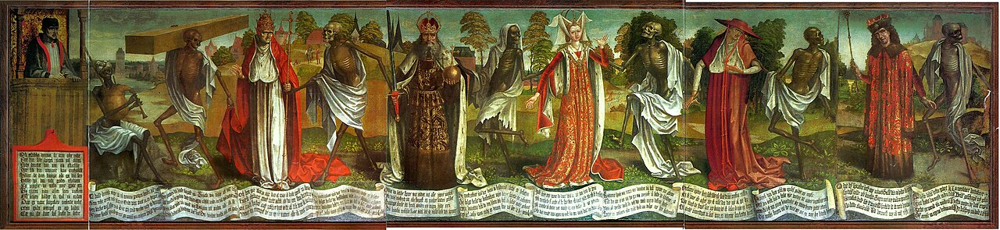

<figure class="photo">

<figcaption>Facade of St. Nicholas' Church & Museum</figcaption>
</figure>
<figure class="photo">

<figcaption><a href="https://commons.wikimedia.org/wiki/File:Bernt_Notke_Danse_Macabre.jpg" target="_blank" rel="noopener noreferrer">Danse Macabre by Bernt Notke</a>, Public domain, via Wikimedia Commons</figcaption>
</figure>

A medieval gothic church, that now functions as a museum. On display is the famous artwork *Danse Macabre* by Bernt Notke, which pictures Death figures dancing with people from all walks of life.
